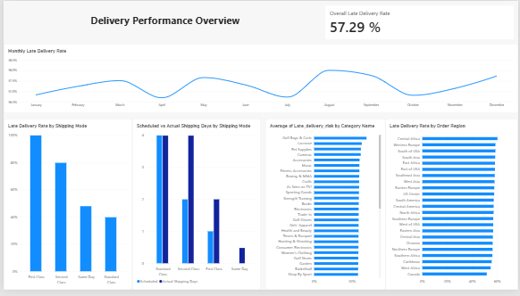
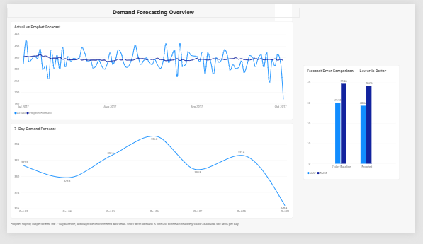

# DataCo Supply Chain Analysis

Supply chain delivery performance analysis and short-term demand forecasting using **Python, Prophet, and Power BI**.

## Project Overview

This project analyzes the DataCo Supply Chain dataset with a focus on two logistics-planning questions:

1. **Where are delivery delays most strongly associated with operational conditions?**
2. **Can short-term daily demand be forecast to support logistics planning?**

The analysis combines data validation, exploratory analysis, time-series forecasting, and Power BI dashboarding.

## Business Questions

The project addresses the following questions:

- Which shipping modes are most strongly associated with late deliveries?
- Do late-delivery rates differ meaningfully by region, product category, or month?
- How large is the gap between scheduled and actual shipping days by shipping mode?
- Can daily order-item volume be forecast for short-term planning?
- Does Prophet outperform a simple 7-day moving-average baseline?

## Data Preparation

Canceled shipments were excluded from operational delivery analysis:

`Delivery Status != 'Shipping canceled'`

The main delivery-performance metric was:

`Late_delivery_risk`

where:

- `1` = late delivery
- `0` = not late

For demand forecasting, the target variable was the daily sum of:

`Order Item Quantity`

## Data Quality Validation

During the forecasting stage, a structural change in the dataset was identified.

Before **2017-10-03**, a single `Order Id` could appear across multiple rows. From **2017-10-03 onward**, each observed order was represented by exactly one row.

Because this change affects row-level quantity measures, the forecasting dataset was restricted to:

**2015-01-01 to 2017-10-02**

This prevents the structural break from being mistaken for a real collapse in demand.

## Delivery Performance Analysis

The overall late-delivery rate, excluding canceled shipments, was approximately:

**57.29%**

### Late Delivery Rate by Shipping Mode

| Shipping Mode | Late Delivery Rate |
|---|---:|
| First Class | 100.0% |
| Second Class | 79.8% |
| Same Day | 47.9% |
| Standard Class | 39.8% |

Shipping Mode showed the largest variation in late-delivery performance.

### Scheduled vs Actual Shipping Days

| Shipping Mode | Scheduled Days | Actual Days |
|---|---:|---:|
| First Class | 1.0 | 2.0 |
| Second Class | 2.0 | ~4.0 |
| Same Day | 0.0 | ~0.48 |
| Standard Class | 4.0 | ~4.0 |

Modes with larger scheduled-versus-actual shipping gaps also showed higher late-delivery rates.

This relationship is interpreted as an **association**, not proven causality.

### Region, Category, and Time

Late-delivery rates by:

- Order Region
- Category Name
- Month

showed relatively small variation compared with Shipping Mode.

This suggests that delivery performance is more strongly associated with the shipping-service structure than with geography, category, or monthly seasonality.

## Demand Forecasting

The forecasting target was:

**Daily sum of `Order Item Quantity`**

with canceled shipments excluded.

### Train/Test Split

- Train period: through **2017-06-30**
- Test period: **2017-07-01 to 2017-10-02**
- Test length: **94 days**

## Baseline Model

A 7-day moving-average baseline was used.

Each day's forecast used the previous 7 actual daily quantities.

### Baseline Performance

- MAE: **29.93**
- RMSE: **39.46**

## Prophet Model

Prophet was evaluated using a walk-forward validation process:

1. Train on all data available up to the previous day
2. Predict the next day
3. Add the actual observed value to the history
4. Retrain
5. Repeat for the full test period

### Prophet Performance

- MAE: **28.64**
- RMSE: **38.26**

Prophet slightly outperformed the 7-day moving-average baseline, although the improvement was modest.

## Time-Series Interpretation

The time-series analysis showed:

- Weak weekday seasonality
- A noticeable decline in the demand level during 2017
- Some yearly/monthly variation, but not fully stable across years

The Prophet improvement therefore appears to come mainly from its ability to model changing demand level and multiple time-series components, rather than from a strong weekday pattern.

## 7-Day Demand Forecast

The final Prophet model was trained using all comparable data through **2017-10-02**.

The 7-day forecast was approximately:

| Date | Forecast |
|---|---:|
| 2017-10-03 | 331.34 |
| 2017-10-04 | 329.83 |
| 2017-10-05 | 332.52 |
| 2017-10-06 | 334.98 |
| 2017-10-07 | 330.83 |
| 2017-10-08 | 332.59 |
| 2017-10-09 | 326.38 |

Short-term demand is therefore expected to remain around:

**330 units per day**

Because the dataset structure changes immediately after 2017-10-02, this forecast is presented as an **operational planning scenario**, not as a directly validated post-period forecast.

## Power BI Dashboard

### Delivery Performance Overview

The dashboard highlights:

- Overall late-delivery rate
- Monthly late-delivery trend
- Shipping Mode performance
- Scheduled vs actual shipping days
- Category-level late-delivery rates
- Regional late-delivery rates

### Demand Forecasting Overview

The forecasting dashboard includes:

- Actual vs Prophet forecast
- Forecast error comparison
- 7-day demand forecast
- Short interpretation of forecast performance

## Key Business Insights

1. **Shipping Mode is the strongest operational dimension associated with late-delivery performance.**
2. **Regional, category, and monthly differences are relatively small compared with Shipping Mode.**
3. **Scheduled-versus-actual shipping gaps are aligned with higher late-delivery rates for some shipping modes.**
4. **Prophet slightly improves forecast accuracy over a simple 7-day baseline.**
5. **Short-term demand remains relatively stable around 330 units per day.**
6. **Data-quality validation is essential because the dataset structure changes on 2017-10-03.**

## Tools Used

- Python
- pandas
- matplotlib
- scikit-learn
- Prophet
- Google Colab
- Power BI

## Repository Files

- `DataCo_Supply_Chain_Analysis.ipynb`  
  Main Python analysis notebook

- `delivery_performance_dashboard.png`  
  Power BI delivery-performance dashboard

- `demand_forecasting_dashboard.png`  
  Power BI demand-forecasting dashboard

- `prophet_result.csv`  
  Walk-forward Prophet actual vs predicted results

- `future_forecast_7days.xlsx`  
  Final 7-day demand forecast
